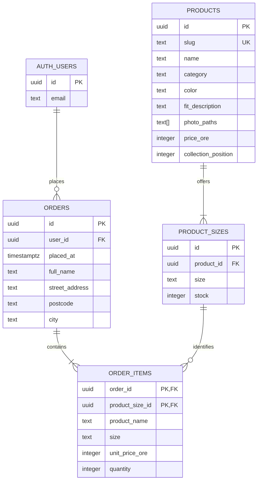

# ER diagram

- `AUTH_USERS` shows the referenced fields of Supabase Auth's managed `auth.users` table.
- Product category is outerwear, tops, or trousers. Each product has at least one photo.
- Collection position is unique and determines the default display order.
- Product ID and size are unique together. Size is XS, S, M, or L, and stock is zero or greater.
- Prices are stored as integer öre and are zero or greater. Order item quantity is greater than zero.
- The order ID serves as the order number. Order totals are calculated from saved line quantities and unit prices.
- Status is calculated from the order's placement time when My orders is loaded.
- Removing a user cascades to their orders. Removing an order cascades to its items.
- Removing a product cascades to its sizes. A size referenced by an order item cannot be deleted.
- App tables have row-level security enabled with no browser policies. The shopping bag is stored in the browser.
